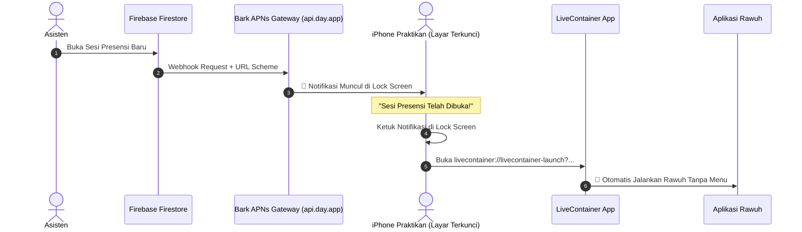

# Panduan Lengkap: Build iOS IPA untuk LiveContainer, Solusi Bug Mach-O, & Push Notification

Dokumen ini berisi panduan teknis menyeluruh untuk membangun (build) aplikasi **Rawuh** menjadi file `.ipa` yang dapat di-sideload langsung ke perangkat iPhone menggunakan **LiveContainer** (tanpa akun Apple Developer berbayar $99/tahun), penjelasan perbaikan kritis bug Mach-O platform agar aplikasi tidak crash saat runtime, serta penerapan sistem **Push Notification** menggunakan protokol **Bark Relay** dan URL Scheme LiveContainer.

---

## Daftar Isi
1. [Arsitektur & Konfigurasi Proyek](#1-arsitektur--konfigurasi-proyek)
2. [Cara Build IPA (Lokal & GitHub Actions)](#2-cara-build-ipa-lokal--github-actions)
3. [Solusi Kritis Bug Mach-O Platform (15 Binary Patch)](#3-solusi-kritis-bug-mach-o-platform-15-binary-patch)
4. [Penerapan Push Notification di LiveContainer (Bark Relay)](#4-penerapan-push-notification-di-livecontainer-bark-relay)
5. [Contoh Integrasi Kode Aplikasi](#5-contoh-integrasi-kode-aplikasi)
6. [Panduan Troubleshooting](#6-panduan-troubleshooting)

---

## 1. Arsitektur & Konfigurasi Proyek

### A. Mengapa Tanpa Akun Developer Berbayar?
Akun Apple gratis ($0) tidak diizinkan oleh Apple untuk membuat sertifikat *Ad-Hoc Distribution* mandiri untuk perangkat fisik. Untuk mengatasinya:
1. Proyek dikompilasi menggunakan profil build EAS dengan target **Release Simulator** (`ios.simulator: true` + `buildConfiguration: "Release"`).
2. Dengan konfigurasi ini, server EAS Cloud mengompilasi kode C++, Swift, dan bundling JavaScript React Native secara penuh ke arsitektur **arm64** tanpa memerlukan sertifikat berbayar Apple.
3. LiveContainer memuat aplikasi guest menggunakan mekanisme dinamis (`dlopen`) dan menandatangani ulang binary secara lokal di iPhone.

### B. Konfigurasi `app.json`
```json
{
  "expo": {
    "name": "Rawuh",
    "slug": "rawuh",
    "scheme": "rawuh",
    "ios": {
      "icon": "./assets/expo.icon",
      "bundleIdentifier": "com.laangid.rawuh",
      "infoPlist": {
        "NSAppTransportSecurity": {
          "NSAllowsArbitraryLoads": true
        }
      }
    }
  }
}
```
> `NSAppTransportSecurity` disetel untuk memastikan koneksi HTTPS Firebase Auth & Firestore berjalan lancar di dalam kontainer.

### C. Konfigurasi Profil `eas.json`
```json
{
  "build": {
    "sideload": {
      "distribution": "internal",
      "ios": {
        "simulator": true,
        "buildConfiguration": "Release"
      },
      "env": {
        "EXPO_PUBLIC_FIREBASE_API_KEY": "${EXPO_PUBLIC_FIREBASE_API_KEY}",
        "EXPO_PUBLIC_FIREBASE_AUTH_DOMAIN": "${EXPO_PUBLIC_FIREBASE_AUTH_DOMAIN}",
        "EXPO_PUBLIC_FIREBASE_PROJECT_ID": "${EXPO_PUBLIC_FIREBASE_PROJECT_ID}",
        "EXPO_PUBLIC_FIREBASE_STORAGE_BUCKET": "${EXPO_PUBLIC_FIREBASE_STORAGE_BUCKET}",
        "EXPO_PUBLIC_FIREBASE_MESSAGING_SENDER_ID": "${EXPO_PUBLIC_FIREBASE_MESSAGING_SENDER_ID}",
        "EXPO_PUBLIC_FIREBASE_APP_ID": "${EXPO_PUBLIC_FIREBASE_APP_ID}"
      }
    }
  }
}
```

---

## 2. Cara Build IPA (Lokal & GitHub Actions)

### Metode 1: Melalui Terminal Laptop
Cukup panggil perintah npm:
```bash
npm run build:ios
```
**Alur yang otomatis berjalan:**
1. Menjalankan `tsc --noEmit` & `expo lint` untuk memastikan kode bebas error.
2. Memicu EAS Cloud Build dengan profil `sideload`.
3. Menunggu hingga proses kompilasi di server cloud Expo selesai.
4. Mengunduh arsip build `.tar.gz` ke direktori `build/`.
5. Menjalankan skrip `repackage-ipa.sh` yang melakukan thinning `arm64`, patching Mach-O 15 binary, dan ad-hoc codesigning.
6. Menghasilkan file siap sideload: **`build/rawuh.ipa`**.

> **Tips:** Jika tidak ingin terminal menunggu cloud build, jalankan:
> ```bash
> npm run build:ios:nowait
> ```
> Setelah selesai di dashboard Expo, unduh filenya lalu jalankan:
> ```bash
> ./scripts/repackage-ipa.sh <path-unduhan.tar.gz> build/rawuh.ipa
> ```

### Metode 2: Melalui GitHub Actions (CI/CD)
1. Daftarkan secret `EXPO_TOKEN` di GitHub repository (**Settings** -> **Secrets and variables** -> **Actions**).
2. Buka tab **Actions** di GitHub -> pilih workflow **Build iOS IPA (LiveContainer Sideload)**.
3. Klik tombol **Run workflow**.
4. Saat build selesai, unduh file `.ipa` langsung dari bagian **Artifacts** di bagian bawah halaman run.

---

## 3. Solusi Kritis Bug Mach-O Platform (15 Binary Patch)

### Masalah Asli:
Saat binary simulator dijalankan di perangkat fisik iPhone melalui LiveContainer, dynamic linker iOS (`dyld`) menolak memuat binary dan memunculkan error fatal:
```text
dlopen(.../Rawuh, 0x0109): tried: '.../Rawuh' (mach-o file ...), 
but incompatible platform (have 'iOS-simulator', need 'iOS')
```
Meskipun binary utama telah di-patch, error serupa tetap muncul untuk library pendukung:
```text
dlopen(.../Rawuh, 0x0109): Library not loaded: @rpath/ExpoFileSystem.framework/ExpoFileSystem
  Reason: (mach-o file ..., but incompatible platform (have 'iOS-simulator', need 'iOS'))
```

### Penyebab Teknis:
Di dalam struktur Mach-O 64-bit iOS, terdapat load command `LC_BUILD_VERSION` (`0x32`). Kompilator simulator memberikan nilai platform **`7`** (`IOSSIMULATOR`), sedangkan kernel fisik iOS hanya menerima nilai **`2`** (`IOS`).

### Solusi Permanen (`scripts/patch-macho.py` & `scripts/repackage-ipa.sh`):
Skrip otomatis kami memindai dan mem-patch **seluruh 15 file binary Mach-O** yang ada di dalam aplikasi:

| No | Komponen Binary | Lokasi di Dalam App |
|:---|:---|:---|
| 1 | **Rawuh** | Binary executable utama aplikasi |
| 2 | **ExpoFileSystem** | `Frameworks/ExpoFileSystem.framework/ExpoFileSystem` |
| 3 | **ExpoFont** | `Frameworks/ExpoFont.framework/ExpoFont` |
| 4 | **ExpoImage** | `Frameworks/ExpoImage.framework/ExpoImage` |
| 5 | **ExpoModulesCore** | `Frameworks/ExpoModulesCore.framework/ExpoModulesCore` |
| 6 | **ExpoModulesJSI** | `Frameworks/ExpoModulesJSI.framework/ExpoModulesJSI` |
| 7 | **ExpoModulesWorklets** | `Frameworks/ExpoModulesWorklets.framework/ExpoModulesWorklets` |
| 8 | **React** | `Frameworks/React.framework/React` |
| 9 | **ReactNativeDependencies** | `Frameworks/ReactNativeDependencies.framework/ReactNativeDependencies` |
| 10 | **hermesvm** | `Frameworks/hermesvm.framework/hermesvm` |
| 11 | **libavif** | `Frameworks/libavif.framework/libavif` |
| 12 | **SDWebImage** | `Frameworks/SDWebImage.framework/SDWebImage` |
| 13 | **SDWebImageAVIFCoder** | `Frameworks/SDWebImageAVIFCoder.framework/SDWebImageAVIFCoder` |
| 14 | **SDWebImageSVGCoder** | `Frameworks/SDWebImageSVGCoder.framework/SDWebImageSVGCoder` |
| 15 | **SDWebImageWebPCoder** | `Frameworks/SDWebImageWebPCoder.framework/SDWebImageWebPCoder` |

**Skrip juga melakukan:**
1. **Thinning ke `arm64`**: Menghapus slice `x86_64` simulator sehingga ukuran IPA berkurang dari ~30 MB menjadi **~17 MB**.
2. **Patching Byte**: Mengubah 4-byte integer platform dari `0x00000007` ke `0x00000002`.
3. **Ad-Hoc Signing**: Memperbarui tanda tangan kode menggunakan `codesign --force --deep --sign -`.

---

## 4. Penerapan Push Notification di LiveContainer (Bark Relay)

### Batasan Sistem:
Aplikasi yang di-sideload dengan akun gratis tidak memiliki entitlement `aps-environment` resmi dari Apple, sehingga tidak bisa menerima remote APNs langsung saat aplikasi mati.

### Solusi Workaround: Bark Relay + LiveContainer Auto-Launch
Menggunakan aplikasi **Bark** (Aplikasi notifikasi open-source resmi dari App Store Apple yang sudah memiliki sertifikat APNs resmi) dan URL scheme resmi LiveContainer.



### Langkah Setup di iPhone:
1. Unduh **Bark** dari App Store di iPhone.
2. Buka aplikasi Bark -> Izinkan akses notifikasi.
3. Di layar utama Bark, catat **Device Key** unik kamu (misal: `xYz12345AbCd`).
   > **Catatan:** Jangan menambah server di menu "Add Server" untuk menghindari error *"Server address is invalid"*. Cukup gunakan server default bawaan `https://api.day.app`.
4. URL notifikasi dengan auto-launch ke LiveContainer:
   ```text
   https://api.day.app/KEY_KAMU/Rawuh/Sesi Presensi Dibuka?url=livecontainer://livecontainer-launch?bundle-name=com.laangid.rawuh&sound=minuet
   ```
5. Saat notifikasi tersebut diketuk di iPhone, iOS akan langsung membuka aplikasi **Rawuh** di dalam LiveContainer secara instan!

---

## 5. Contoh Integrasi Kode Aplikasi

File utilitas pengiriman notifikasi: `src/services/notificationRelay.ts`

```typescript
/**
 * Utility Pengirim Push Notification via Bark Relay untuk LiveContainer
 */

const LC_LAUNCH_URL = 'livecontainer://livecontainer-launch?bundle-name=com.laangid.rawuh';

export interface NotificationPayload {
  title: string;
  body: string;
  barkKey: string;
}

export async function sendPushNotification(payload: NotificationPayload): Promise<boolean> {
  const { title, body, barkKey } = payload;
  if (!barkKey) return false;

  const endpoint = `https://api.day.app/${encodeURIComponent(barkKey)}/${encodeURIComponent(title)}/${encodeURIComponent(body)}`;
  const params = new URLSearchParams({
    url: LC_LAUNCH_URL,
    group: 'rawuh',
    sound: 'minuet',
  });

  try {
    const res = await fetch(`${endpoint}?${params.toString()}`);
    return res.ok;
  } catch (error) {
    console.warn('[PushRelay] Gagal mengirim notifikasi:', error);
    return false;
  }
}
```

---

## 6. Panduan Troubleshooting

| Gejala Error | Penyebab | Solusi |
|:---|:---|:---|
| `incompatible platform (have 'iOS-simulator', need 'iOS')` | Masih ada binary atau framework yang belum di-patch dari platform `7` ke `2`. | Jalankan `./scripts/repackage-ipa.sh build/rawuh-build.tar.gz build/rawuh.ipa` versi terbaru (mem-patch seluruh 15 binary). |
| *"Server address is invalid"* di Bark | Pengguna mencoba menambahkan server custom dengan URL tidak lengkap. | Hapus server custom, gunakan server default bawaan Bark (`https://api.day.app`). |
| Notifikasi Lokal tidak muncul di LiveContainer | Izin notifikasi lokal belum diaktifkan di container. | Di LiveContainer, **tekan tahan (long-press) ikon Rawuh** -> **Settings** -> aktifkan **"Fix File Picker & Local Notification"**. |
| Kuota App ID Apple habis saat update app | Meng-uninstall app lama lalu install app baru di SideStore. | Jangan uninstall. Cukup timpa (in-place update) dengan mengimpor IPA baru yang memiliki `bundleIdentifier` sama (`com.laangid.rawuh`). |
| Update kode tanpa build IPA ulang | Ingin memperbarui tampilan/fitur tanpa menyentuh komputer atau SideStore. | Gunakan **Expo OTA Updates** (`npx eas update --branch production`). Kode JavaScript langsung terbarui over-the-air. |

---

*Dokumen ini dibuat otomatis sebagai referensi teknis implementasi mobile iOS untuk aplikasi Rawuh.*
